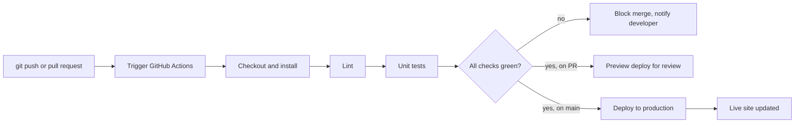
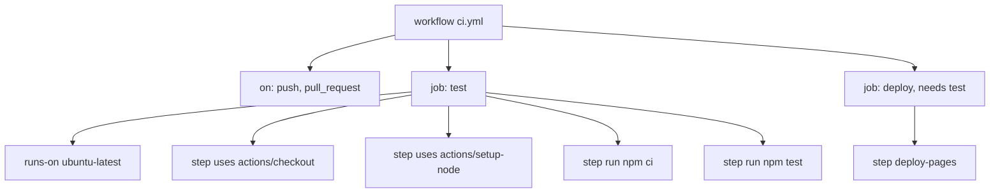
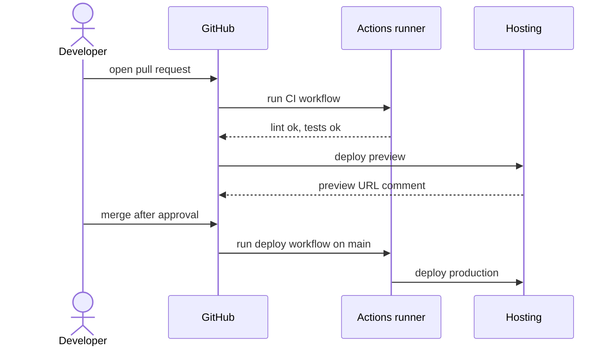
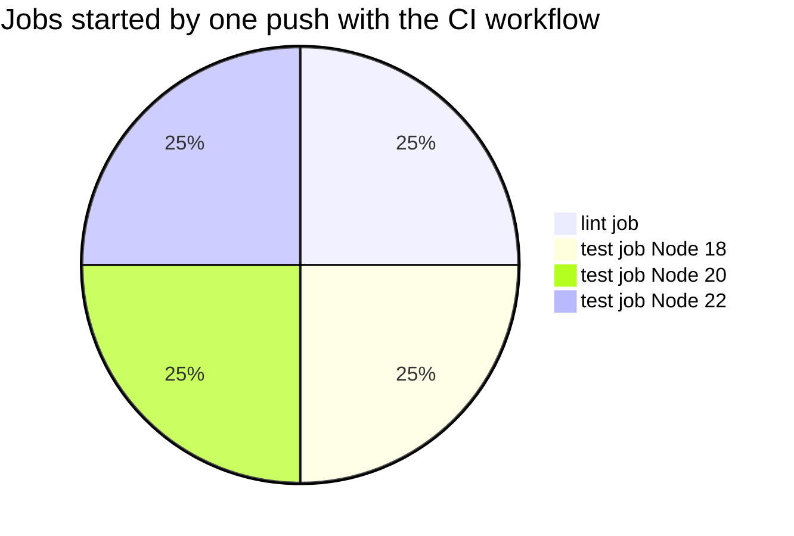

# Session 6 · Continuous Integration and Deployment with GitHub

> [Prime AI – Software Engineering with AI](../../README.md) › [Term 1](../README.md) › [Distributed Version Control with Git & GitHub](README.md) › **Session 6**

| ⏱ Estimated time | 🧩 Prerequisites |
|---|---|
| 3.5 hours | Sessions 1–5; Session 5 tests |

[⬅ Previous: AI Integration with Git and GitHub](session-05-ai-integration-with-git-and-github.md) &nbsp;|&nbsp; [Practice test ➡](practice-test.md)

---

## 🎯 Learning objectives

By the end of this session you will be able to:

- Define CI/CD (continuous integration, delivery and deployment) and explain why modern teams depend on it.
- Explain GitHub Actions concepts – workflows, events, jobs, steps, runners, actions, secrets – and YAML basics.
- Implement a CI workflow that lints and tests every push and pull request.
- Deploy websites automatically with GitHub Pages, and know when to use Netlify, Vercel and other third-party services.
- Protect branches with required checks and use GitHub for releases and project management.

## 📖 Concepts

### 1. What is CI/CD?

| Term | Meaning | Example |
|---|---|---|
| **Continuous Integration (CI)** | Every change is merged frequently and **automatically built and tested** | Each push runs `npm test`; the PR shows ✅ or ❌ |
| **Continuous Delivery** | Every change that passes CI is **ready to release**; a human clicks "deploy" | Staging site updated automatically; production after approval |
| **Continuous Deployment** | Every change that passes CI is **released automatically** | Merge to `main` → live site updates in a minute |

> 🏭 **Analogy – a factory assembly line with quality control.** Developers drop parts (commits) on the line. Robots (CI)
> check every part immediately – size, weight, function. Only parts that pass move on to packing and shipping (CD).
> Problems are caught minutes after they are made, not weeks later by customers.

**Why it matters:** bugs found early are cheap to fix; nobody "forgets" to run tests; releases become small and boring
(good!); reviewers see test results on every PR; deployment is repeatable instead of manual FTP uploads.

### 2. GitHub Actions – the vocabulary

| Concept | Meaning |
|---|---|
| **Workflow** | An automated process defined in a YAML file in `.github/workflows/` |
| **Event** (trigger) | What starts it: `push`, `pull_request`, `schedule` (cron), `workflow_dispatch` (manual button), `release` |
| **Job** | A set of steps that runs on one **runner**; jobs run in parallel unless `needs:` creates an order |
| **Runner** | The machine: GitHub-hosted `ubuntu-latest`, `windows-latest`, `macos-latest`, or self-hosted |
| **Step** | One command (`run:`) or one reusable **action** (`uses:`) |
| **Action** | A packaged step from the Marketplace, e.g. `actions/checkout@v4`, `actions/setup-node@v4` |
| **Secrets & variables** | Encrypted values (API tokens) set in *Settings › Secrets and variables › Actions*, used as `${{ secrets.NAME }}` |
| **Artifacts / cache** | Files saved from a run (build output, reports) / dependency cache to speed up runs |
| **Matrix** | Run the same job for several versions, e.g. Node 18, 20 and 22 |

Public repositories get free GitHub-hosted minutes; private repositories have a monthly free allowance.

### 3. YAML basics (enough for workflows)

```yaml
name: CI                     # key: value
on:                          # nested map – indentation (2 spaces) matters, never tabs
  push:
    branches: [main]         # inline list
jobs:
  test:
    runs-on: ubuntu-latest
    steps:                   # list items start with "- "
      - uses: actions/checkout@v4
      - name: Run tests
        run: npm test        # a shell command
```

Rules: indentation defines structure; `-` starts a list item; strings usually need no quotes (quote them if they contain
`:` or start with special characters); `#` starts a comment; `${{ }}` inserts expressions such as `${{ matrix.node }}`.

### 4. A CI workflow – step by step

1. Create `.github/workflows/ci.yml` in your repository.
2. Trigger on `push` and `pull_request` to `main`.
3. Job `test` on `ubuntu-latest`.
4. Steps: **checkout** the code → **set up Node** (with npm cache) → **install** (`npm ci`) → **lint** → **test**.
5. Commit and push → open the **Actions** tab to watch the run; click a step to see its log.
6. Add a **status badge** to README: ``.
7. **Protect `main`**: *Settings › Branches* (or Rulesets) → require a pull request and the `test` check to pass before
   merging. Now broken code cannot reach `main`.

### 5. Continuous deployment of a website

**GitHub Pages (static sites, free):**
- Simplest: *Settings › Pages › Deploy from a branch* (Session 6 of Module 3).
- With Actions: *Settings › Pages › Source: GitHub Actions*, then a workflow that uploads the site with
  `actions/upload-pages-artifact` and deploys with `actions/deploy-pages` – so you can test (or build) before deploying.

**Third-party hosting services that connect to GitHub:**

| Service | Good for | How it connects |
|---|---|---|
| **Netlify** | Static sites, forms, serverless functions | Import repo → auto-deploy on push, **deploy previews** for every PR |
| **Vercel** | Front-end frameworks (Next.js, React), static sites | Import repo → previews per PR, production on `main` |
| **Render / Railway** | Back-end apps, databases (Node, PHP, Python) | Deploy from repo, environment variables |
| **Cloudflare Pages** | Static sites on a global CDN | Git integration |
| **Azure Static Web Apps / Azure App Service** | Microsoft cloud (Term 4) | Generated GitHub Actions workflow |

**Other services that plug into the pipeline:** **Dependabot** (automatic dependency-update PRs and security alerts),
**CodeQL / code scanning** (security analysis), **Codecov** (test coverage reports), **SonarCloud** (code quality),
**Snyk** (vulnerabilities), **Lighthouse CI** (performance budgets).

### 6. Using GitHub for project management and releases

- **Issues** with labels (`bug`, `enhancement`, `good first issue`), assignees and milestones.
- **Projects** – Kanban boards/tables linked to issues and PRs (To do → In progress → Done), automated by PR status.
- **Pull-request templates** (`.github/pull_request_template.md`) and **issue templates**.
- **Releases** from tags with notes (auto-generated from PR titles) – CD can deploy when a release is published.
- **Environments** (staging, production) with required reviewers and secrets per environment.

## 🧭 Diagrams

### A CI/CD pipeline for a website



### Anatomy of a workflow file



### Pull request with required checks



## 💻 Worked examples

### Example 1 — The CI workflow (GitHub Actions YAML)

This workflow lives in the demo project [`code/session-06_ci-demo/`](code/session-06_ci-demo/). Copy that folder into a new
GitHub repository and the workflow runs on every push and pull request. It lints, then tests on **three Node versions**
using a matrix.

```yaml
# .github/workflows/ci.yml – lint and test every push and pull request
name: CI

on:
  push:
    branches: [main]
  pull_request:
    branches: [main]
  workflow_dispatch:          # adds a "Run workflow" button in the Actions tab

jobs:
  lint:
    runs-on: ubuntu-latest
    steps:
      - uses: actions/checkout@v4
      - uses: actions/setup-node@v4
        with:
          node-version: 20
      - name: Lint source files
        run: npm run lint

  test:
    needs: lint               # only test if lint passed
    runs-on: ubuntu-latest
    strategy:
      matrix:
        node: [18, 20, 22]
    steps:
      - uses: actions/checkout@v4
      - uses: actions/setup-node@v4
        with:
          node-version: ${{ matrix.node }}
      - name: Run unit tests
        run: npm test
```

📄 Saved as [`code/session-06_ci-demo/.github/workflows/ci.yml`](code/session-06_ci-demo/.github/workflows/ci.yml)

### Example 2 — Running the same pipeline locally before you push

CI should never be the first place your tests run. This script performs the same steps as the workflow – lint, then
tests – on the demo project, prints a GitHub-style summary, and then shows what happens when a bug and a lint error are
introduced (in a temporary copy).

```bash
#!/usr/bin/env bash
# session-06_local-ci.sh – run the CI steps locally: lint + test, then a deliberately broken copy.
cd "$(dirname "$0")/session-06_ci-demo"

pipeline() {
  local status=0
  echo "▶ lint";  if npm run -s lint;  then echo "  ✔ lint passed"; else echo "  ✘ lint failed"; status=1; fi
  if [ $status -eq 0 ]; then
    echo "▶ test"
    if npm test -s 2>&1 | sed -E 's/ \([0-9.]+m?s\)//' | grep -E '^\s*(✔|✖|ℹ (tests|pass|fail))' | sed -E 's/^\s+/  /' | awk '!seen[$0]++'; then :; fi
    npm test -s >/dev/null 2>&1 || status=1
  else
    echo "▶ test  (skipped – needs: lint)"
  fi
  [ $status -eq 0 ] && echo "RESULT: ✅ all checks passed" || echo "RESULT: ❌ checks failed – merge would be blocked"
}

echo "===== clean project ====="
pipeline

echo; echo "===== broken copy: a bug and a console.log ====="
TMP="$(mktemp -d)"; cp -r . "$TMP/"; cd "$TMP"
sed -i 's/return subtotal > FREE_ABOVE ? 0 : FEE;/console.log(subtotal); return subtotal >= FREE_ABOVE ? 0 : FEE;/' src/cart.js
pipeline
echo; echo "===== broken copy, lint fixed but bug remains ====="
sed -i 's/console.log(subtotal); //' src/cart.js
pipeline
```

📄 Saved as [`code/session-06_local-ci.sh`](code/session-06_local-ci.sh)

**Output** (real run)

```text
===== clean project =====
▶ lint
  ✔ lint passed
▶ test
✔ subtotal multiplies price by quantity
✔ delivery is Rs 250 up to Rs 5,000
✔ delivery is free above Rs 5,000
✔ empty cart costs nothing
✔ total adds delivery
ℹ tests 5
ℹ pass 5
ℹ fail 0
RESULT: ✅ all checks passed

===== broken copy: a bug and a console.log =====
▶ lint
  src/cart.js:11  no console.log in source code
  ✘ lint failed
▶ test  (skipped – needs: lint)
RESULT: ❌ checks failed – merge would be blocked

===== broken copy, lint fixed but bug remains =====
▶ lint
  ✔ lint passed
▶ test
✔ subtotal multiplies price by quantity
✖ delivery is Rs 250 up to Rs 5,000
✔ delivery is free above Rs 5,000
✔ empty cart costs nothing
✔ total adds delivery
ℹ tests 5
ℹ pass 4
ℹ fail 1
✖ failing tests:
RESULT: ❌ checks failed – merge would be blocked
```

### Example 3 — A workflow checker: catch YAML mistakes before GitHub does

A typo in a workflow file wastes a CI run. This script contains a **tiny YAML parser** (enough for workflow files: maps,
lists and scalars by indentation) and checks the rules from this session: triggers present, every job has `runs-on` and
steps, checkout comes first, actions are version-pinned, no hard-coded secrets, no tab characters. It checks the real
`ci.yml` and a broken sample.

```js
// session-06_workflow-check.js  (run: node session-06_workflow-check.js)
// Minimal YAML parser (maps, lists, scalars) + GitHub Actions workflow lint rules.
const fs = require('fs');
const path = require('path');

function parseYAML(text) {
  const lines = text.split('\n').map(l => l.replace(/\s+#.*$/, '')).filter(l => l.trim() && !l.trim().startsWith('#'));
  let i = 0;
  const indentOf = l => l.match(/^ */)[0].length;
  const scalar = v => {
    v = v.trim();
    if (/^\[.*\]$/.test(v)) return v.slice(1, -1).split(',').map(s => scalar(s));
    if (/^\d+$/.test(v)) return +v;
    return v.replace(/^['"]|['"]$/g, '');
  };
  function block(indent) {
    if (lines[i].trim().startsWith('- ')) {               // a list
      const arr = [];
      while (i < lines.length && indentOf(lines[i]) === indent && lines[i].trim().startsWith('- ')) {
        const rest = lines[i].trim().slice(2);
        if (/^[\w-]+:/.test(rest)) {                       // "- key: value" starts a map item
          lines[i] = ' '.repeat(indent + 2) + rest;
          arr.push(block(indent + 2));
        } else { arr.push(scalar(rest)); i++; }
      }
      return arr;
    }
    const obj = {};
    while (i < lines.length && indentOf(lines[i]) === indent) {
      const m = lines[i].trim().match(/^([\w.-]+):\s*(.*)$/);
      if (!m) throw new Error(`cannot parse line: "${lines[i].trim()}"`);
      i++;
      if (m[2] !== '') obj[m[1]] = scalar(m[2]);
      else if (i < lines.length && indentOf(lines[i]) > indent) obj[m[1]] = block(indentOf(lines[i]));
      else obj[m[1]] = null;
    }
    return obj;
  }
  return block(0);
}

function check(name, text) {
  const problems = [];
  if (/\t/.test(text)) problems.push('tab characters found – YAML needs spaces');
  let wf;
  try { wf = parseYAML(text); } catch (e) { console.log(`✘ ${name}: ${e.message}`); return; }
  if (!wf.on) problems.push('missing "on:" triggers');
  if (!wf.jobs || !Object.keys(wf.jobs).length) problems.push('no jobs defined');
  for (const [job, def] of Object.entries(wf.jobs || {})) {
    if (!def['runs-on']) problems.push(`job "${job}" has no runs-on`);
    const steps = def.steps || [];
    if (!steps.length) problems.push(`job "${job}" has no steps`);
    if (steps.length && !String(steps[0].uses || '').startsWith('actions/checkout')) problems.push(`job "${job}": first step should be actions/checkout`);
    steps.forEach((s, k) => {
      if (!s.uses && !s.run) problems.push(`job "${job}" step ${k + 1} has neither uses nor run`);
      if (s.uses && !/@/.test(s.uses)) problems.push(`job "${job}" step ${k + 1}: pin a version, e.g. ${s.uses}@v4`);
      if (/(token|password|api[_-]?key)\s*[:=]\s*[A-Za-z0-9]{12,}/i.test(String(s.run || ''))) problems.push(`job "${job}" step ${k + 1}: hard-coded secret – use \${{ secrets.NAME }}`);
    });
    if (def.needs && !(wf.jobs[def.needs])) problems.push(`job "${job}" needs unknown job "${def.needs}"`);
  }
  const jobs = Object.keys(wf.jobs || {});
  console.log(`${problems.length ? '✘' : '✔'} ${name}: triggers=${Object.keys(wf.on || {}).join(',') || '-'} jobs=${jobs.join(',') || '-'}`);
  problems.forEach(p => console.log(`    - ${p}`));
  if (!problems.length) {
    const t = wf.jobs.test;
    if (t?.strategy?.matrix) console.log(`    matrix: node ${t.strategy.matrix.node.join(', ')} → ${t.strategy.matrix.node.length} parallel test jobs`);
  }
}

check('ci.yml', fs.readFileSync(path.join(__dirname, 'session-06_ci-demo/.github/workflows/ci.yml'), 'utf8'));
check('pages.yml', fs.readFileSync(path.join(__dirname, 'session-06_ci-demo/.github/workflows/pages.yml'), 'utf8'));
check('broken.yml (sample)', `name: Broken
jobs:
  build:
    steps:
      - uses: actions/setup-node
      - name: Deploy
        run: curl -H "token: abc123def456ghi789" https://example.com/deploy
  deploy:
    needs: biuld
    runs-on: ubuntu-latest
    steps:
      - name: nothing here
`);
```

📄 Saved as [`code/session-06_workflow-check.js`](code/session-06_workflow-check.js)

**Output** (real run)

```text
✔ ci.yml: triggers=push,pull_request,workflow_dispatch jobs=lint,test
    matrix: node 18, 20, 22 → 3 parallel test jobs
✔ pages.yml: triggers=push,workflow_dispatch jobs=test,deploy
✘ broken.yml (sample): triggers=- jobs=build,deploy
    - missing "on:" triggers
    - job "build" has no runs-on
    - job "build": first step should be actions/checkout
    - job "build" step 1: pin a version, e.g. actions/setup-node@v4
    - job "build" step 2: hard-coded secret – use ${{ secrets.NAME }}
    - job "deploy": first step should be actions/checkout
    - job "deploy" step 1 has neither uses nor run
    - job "deploy" needs unknown job "biuld"
```

## 🧩 Real-life coding problem

**Scenario – automatic, safe deployment of the bakery site.** The owner wants every approved change to appear on the live
site automatically, but never a broken version. Build the pipeline:

1. **CI** on every PR: lint + unit tests (the `ci.yml` above).
2. **Branch protection**: PR + 1 approval + green `test` checks required for `main`.
3. **CD** on `main`: a Pages workflow that runs the tests again and, only if they pass, uploads and deploys the `site/`
   folder to GitHub Pages.
4. A **CI badge** and the live link in the README.

The deployment workflow – [`code/session-06_ci-demo/.github/workflows/pages.yml`](code/session-06_ci-demo/.github/workflows/pages.yml):

```yaml
name: Deploy site to GitHub Pages
on:
  push:
    branches: [main]
  workflow_dispatch:
permissions:
  contents: read
  pages: write
  id-token: write
concurrency:
  group: pages
  cancel-in-progress: true
jobs:
  test:
    runs-on: ubuntu-latest
    steps:
      - uses: actions/checkout@v4
      - uses: actions/setup-node@v4
        with:
          node-version: 20
      - run: npm test
  deploy:
    needs: test
    runs-on: ubuntu-latest
    environment:
      name: github-pages
    steps:
      - uses: actions/checkout@v4
      - uses: actions/configure-pages@v5
      - uses: actions/upload-pages-artifact@v3
        with:
          path: site
      - uses: actions/deploy-pages@v4
```

**Turn it on:** *Settings › Pages › Source: GitHub Actions*. After the first green run, the site is live at
`https://<user>.github.io/<repo>/`. The demo project's own tests (run locally above) are what protect the live site:
the broken copy in Example 2 would stop at ❌ and never deploy.

## ⚠️ Common mistakes

| Mistake | Symptom | Fix |
|---|---|---|
| Workflow not in `.github/workflows/` | Nothing runs | Exact folder path at the repository root |
| Tabs or wrong indentation in YAML | "Invalid workflow file" | 2 spaces, use an editor with YAML support / the checker script |
| Unpinned actions (`uses: actions/checkout`) | Breaks when the action changes | Pin a major version (`@v4`) or a commit SHA |
| Secrets typed into YAML | Leaked credentials in the repo | *Settings › Secrets*, use `${{ secrets.NAME }}` |
| `npm install` instead of `npm ci` in CI | Non-reproducible installs | `npm ci` with a committed lockfile |
| CI exists but `main` isn't protected | Broken code merged anyway | Require status checks and reviews |
| Deploy job not depending on tests | Broken site deployed | `needs: test` |
| Ignoring red builds | Bugs pile up, CI becomes noise | Fix or revert immediately – a red main is everyone's problem |

## 🌟 Best practices

- Run lint and tests locally (or with a pre-push hook) before pushing; keep CI fast (< 5 minutes) with caching.
- Trigger CI on pull requests; require it through branch protection; show a badge in the README.
- Separate jobs (lint → test → deploy) with `needs:`; deploy only from `main` (or on releases) and use environments for production.
- Pin action versions, use least-privilege `permissions:`, keep secrets in GitHub Secrets, enable Dependabot and code scanning.
- Use deploy previews (Netlify/Vercel) for visual review of every PR.
- Treat workflow files as code: review them in PRs and document them in the README.

## 🏗️ Mini project

**Mini project / module capstone – ship a project with CI/CD.** Take the demo project (or your own site), push it to a new
GitHub repository and:
1. Enable the CI workflow and make it pass on three Node versions.
2. Protect `main` (PR + passing checks).
3. Deploy `site/` with the Pages workflow; add the badge and live link to the README.
4. Open a PR that breaks a test – screenshot the red check blocking the merge – then fix it and merge.
5. Tag `v1.0.0` and publish a GitHub Release with auto-generated notes.

The demo project's README walks through every step: [`code/session-06_ci-demo/README.md`](code/session-06_ci-demo/README.md).

## 📦 Project files for this session

| File | What it is |
|---|---|
| 📄 [`code/session-06_ci-demo/package.json`](code/session-06_ci-demo/package.json) | Demo project – npm scripts used by CI (lint and test, no dependencies) |
| 📄 [`code/session-06_ci-demo/src/cart.js`](code/session-06_ci-demo/src/cart.js) | Demo project – cart logic under test |
| 📄 [`code/session-06_ci-demo/test/cart.test.js`](code/session-06_ci-demo/test/cart.test.js) | Demo project – unit tests run by CI |
| 📄 [`code/session-06_ci-demo/scripts/lint.js`](code/session-06_ci-demo/scripts/lint.js) | Demo project – a tiny linter (no console.log, no var, no trailing spaces) |
| 📄 [`code/session-06_ci-demo/.github/workflows/pages.yml`](code/session-06_ci-demo/.github/workflows/pages.yml) | Demo project – deploy workflow: test, then publish site/ to GitHub Pages |
| 📄 [`code/session-06_ci-demo/site/index.html`](code/session-06_ci-demo/site/index.html) | Demo project – the static page that the Pages workflow deploys |
| 📄 [`code/session-06_ci-demo/.github/pull_request_template.md`](code/session-06_ci-demo/.github/pull_request_template.md) | Demo project – pull request template shown on every new PR |
| 📄 [`code/session-06_ci-demo/netlify.toml`](code/session-06_ci-demo/netlify.toml) | Demo project – optional Netlify configuration (deploy site/ after tests) |
| 📄 [`code/session-06_ci-demo/README.md`](code/session-06_ci-demo/README.md) | Demo project – README with badge, live link and step-by-step CI/CD instructions |

## 📊 At a glance

**What the local pipeline found in each version of the project** (real output of `session-06_local-ci.sh`):

| Version | Lint | Tests | Merge allowed? |
|---|---|---|---|
| Clean project | ✅ | ✅ 5/5 | Yes |
| Bug + `console.log` | ❌ | skipped (`needs: lint`) | No |
| Bug only | ✅ | ❌ (boundary test fails) | No |



## 🧪 Lab / practice tasks

**🟢 Easy** — Create a repository with the demo project, push it and watch the CI workflow run in the Actions tab. Add the status badge to the README.

<details><summary>💡 Hint</summary>

The badge URL is shown under the "..." menu of a workflow run: *Create status badge*.

</details>

<details><summary>✅ Solution</summary>

After the first push, the Actions tab shows "CI" with one `lint` job and three `test (18/20/22)` jobs, all green. The README
badge: `` renders "CI passing".

</details>

**🟡 Medium** — Add a third job `audit` that runs only on pull requests and prints the list of changed files (`git diff --name-only origin/main...HEAD`). Use `actions/checkout@v4` with `fetch-depth: 0`.

<details><summary>💡 Hint</summary>

Use `if: github.event_name == 'pull_request'` on the job; full history is needed for the diff.

</details>

<details><summary>✅ Solution</summary>

```yaml
  audit:
    if: github.event_name == 'pull_request'
    runs-on: ubuntu-latest
    steps:
      - uses: actions/checkout@v4
        with:
          fetch-depth: 0
      - name: Changed files
        run: git diff --name-only origin/${{ github.base_ref }}...HEAD
```

</details>

**🔴 Hard** — Protect `main` so a PR needs one approval and passing `test` checks. Then open a PR that changes the delivery fee without updating tests, and document (with screenshots) how the merge is blocked and how you fixed it.

<details><summary>💡 Hint</summary>

Settings › Branches › Add rule (or Rulesets) › Require status checks to pass › search for "test".

</details>

<details><summary>✅ Solution</summary>

Evidence should show: the rule configuration; the PR page with "Some checks were not successful" and the merge button
disabled; the failing test log (`delivery is Rs 250 up to Rs 5,000` expected 250, got 300); the fixing commit; green checks;
the approval; and the merged PR. Bonus: Pages workflow redeploys after the merge.

</details>

**🏆 Challenge** — Connect the same repository to **Netlify** (or Vercel) using `netlify.toml`, enable deploy previews, and compare it with the GitHub Pages workflow: setup time, preview URLs per PR, build logs, custom domains and limits.

<details><summary>💡 Hint</summary>

Netlify: *Add new site › Import an existing project › GitHub*; it reads netlify.toml automatically.

</details>

<details><summary>✅ Solution</summary>

A good comparison notes: Netlify posts a preview URL on every PR automatically (great for design review), its build fails when
`npm test` fails (so broken code is not published), custom domains + HTTPS are simple; GitHub Pages keeps everything inside
GitHub, needs a workflow for testing-before-deploy, and has no per-PR previews without extra setup.

</details>

## ✅ Quick quiz

**Q1. Continuous Integration means:**

- A) Deploying once a year
- B) Automatically building and testing every change that is integrated
- C) Writing code without tests
- D) Manual FTP uploads

<details><summary>Show answer</summary>

**B** — Catch problems early.

</details>

**Q2. Where must GitHub Actions workflow files be stored?**

- A) /workflows
- B) .github/workflows/
- C) .git/actions
- D) docs/

<details><summary>Show answer</summary>

**B** — At the repository root.

</details>

**Q3. `needs: test` on a job means:**

- A) It runs before test
- B) It runs only after the test job succeeds
- C) It replaces test
- D) It runs in parallel always

<details><summary>Show answer</summary>

**B** — needs creates a dependency.

</details>

**Q4. Which step should usually come first in a job?**

- A) npm test
- B) actions/checkout
- C) deploy
- D) upload artifact

<details><summary>Show answer</summary>

**B** — The runner starts empty.

</details>

**Q5. Which service gives automatic deploy previews for every pull request?**

- A) Git
- B) Netlify or Vercel
- C) npm
- D) SSH

<details><summary>Show answer</summary>

**B** — Both create preview URLs per PR.

</details>

## 📝 Summary / cheat-sheet

- CI = automatically build and test every change; Continuous Delivery = always releasable; Continuous Deployment = auto-release.
- GitHub Actions: workflow (YAML in `.github/workflows/`) → events → jobs on runners → steps (`uses:` actions / `run:` commands).
- YAML: 2-space indentation, `key: value`, `- ` list items, `${{ }}` expressions, no tabs.
- Typical CI: checkout → setup-node → `npm ci` → lint → test (matrix of versions), required via branch protection.
- CD: GitHub Pages via Actions (upload-pages-artifact + deploy-pages) or Netlify/Vercel/Render with previews.
- Secure pipelines: pinned actions, least-privilege permissions, secrets in GitHub Secrets, Dependabot and code scanning.

## 🎤 Interview / viva questions

1. **Explain the difference between continuous delivery and continuous deployment.**
   <details><summary>Model answer</summary>

   Both keep every change in a releasable state after automated tests; delivery needs a human to approve the release, deployment releases automatically.

   </details>

2. **What are the main parts of a GitHub Actions workflow?**
   <details><summary>Model answer</summary>

   Triggers (on), jobs that run on runners, and steps inside each job that either use actions or run shell commands; plus optional secrets, matrices and dependencies.

   </details>

3. **Why use npm ci rather than npm install in CI?**
   <details><summary>Model answer</summary>

   npm ci installs exactly what the lockfile specifies, from a clean state, giving fast and reproducible builds.

   </details>

4. **How do you stop broken code reaching main?**
   <details><summary>Model answer</summary>

   Run CI on pull requests and enable branch protection requiring passing status checks and reviews before merging.

   </details>

5. **How would you keep an API key safe in a workflow?**
   <details><summary>Model answer</summary>

   Store it as an encrypted repository or environment secret and reference it with the secrets context; never write it in the YAML or code.

   </details>

6. **Name three third-party services that integrate with GitHub in a pipeline.**
   <details><summary>Model answer</summary>

   Netlify or Vercel for hosting with previews, Dependabot or Snyk for dependency security, and Codecov or SonarCloud for coverage and code quality.

   </details>

---

[⬅ Previous: AI Integration with Git and GitHub](session-05-ai-integration-with-git-and-github.md) &nbsp;|&nbsp; [Practice test ➡](practice-test.md)

<sub>Prepared by **Hamna Zahid Khan**, Junior Lecturer · Prime AI – Software Engineering with AI</sub>
