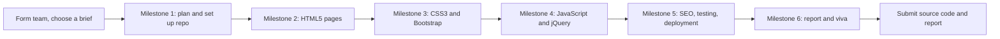
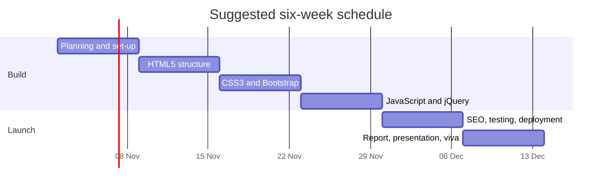
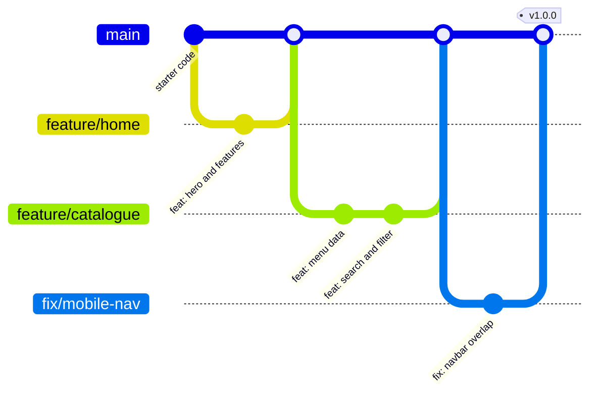

# 🎓 Term 1 Capstone Project – Responsive Website

> [Prime AI – Software Engineering with AI](../../README.md) › [Term 1](../README.md) › **Capstone Project**

Prepared by **Hamna Zahid Khan**, Junior Lecturer

The Term 1 Capstone Project brings together everything from this term – **HTML5, CSS3, JavaScript, Bootstrap and
jQuery**, plus the **SEO** and **Git/GitHub** practices from Modules 4 and 5 – in one complete, professional website built by
a small team. You will plan it, build it in milestones, test it, publish it on the web and defend it in a viva.

## 📌 Project facts

| Item | Details |
|---|---|
| **Team size** | Group project – **maximum 4 students** per team |
| **Technologies** | HTML5, CSS3, JavaScript, Bootstrap 5, jQuery (SEO and Git/GitHub practices expected) |
| **Duration** | Six milestones (suggested one per week; your centre decides the total project hours) |
| **Deliverables** | 1. **Project source code** (GitHub repository + live site) · 2. **Project report** (soft copy, MS Word format) |
| **Evaluation** | Source code and working application **60%** · Project report **20%** · Project viva **20%** |
| **Starter code** | [`starter-code/`](starter-code/) – a working four-page Bootstrap + jQuery site with TODOs |

## 🧭 How the capstone runs





*Dates are an example – your lecturer will give the real schedule.*

## 🗂️ Milestones

| # | Milestone | Suggested timing |
|---|---|---|
| 1 | [Planning, Team and Repository Set-up](milestones/01-planning-and-setup/README.md) | Week 1 |
| 2 | [HTML5 Structure and Content](milestones/02-html5-structure-and-content/README.md) | Week 2 |
| 3 | [CSS3 and Bootstrap Responsive Design](milestones/03-css3-and-bootstrap-responsive-design/README.md) | Week 3 |
| 4 | [JavaScript and jQuery Interactivity](milestones/04-javascript-and-jquery-interactivity/README.md) | Week 4 |
| 5 | [SEO, Accessibility, Testing and Deployment](milestones/05-seo-accessibility-and-deployment/README.md) | Week 5 |
| 6 | [Project Report, Presentation and Viva](milestones/06-report-presentation-and-viva/README.md) | Week 6 |

Each milestone page lists the tasks step by step, the deliverable, an acceptance checklist, hints and the Git commands to
use.

## 💡 Choose one project brief

Every brief needs the **same core features** (next section); the content and extra features differ. Teams may propose
their own idea of similar size – get it approved in Milestone 1.

| Brief | Website for… | Catalogue page shows | Extra feature ideas |
|---|---|---|---|
| **A. Karachi Eats** | A restaurant or home-food business | Menu items by category (desserts, mains, drinks) | Order basket with total, opening-hours "open now" badge |
| **B. EduFind** | A training institute or tuition centre | Courses by level and subject | Course comparison table, fee calculator, enrolment form |
| **C. Explore Pakistan** | A tourism company | Tours/destinations by region | Trip cost estimator, photo gallery with lightbox, itinerary accordion |
| **D. GreenCart** | An eco-friendly online shop | Products by category | Wishlist page using `localStorage`, price sort, coupon field |
| **E. Clinic Connect** | A medical clinic | Doctors by speciality | Appointment request form with date/time validation, FAQ |

## ✅ Required features (core)

| Area | Must have | Module |
|---|---|---|
| **Pages** | At least **5 pages**: Home, Catalogue/Listing, About, Contact + one page specific to your brief | 2 |
| **HTML5** | Semantic layout (`header`/`nav`/`main`/`section`/`article`/`footer`), one `h1` per page, valid markup, a table, a form, media (image/video/map) | 2 |
| **CSS3** | Custom stylesheet with variables, Flexbox/Grid, transitions or animations, consistent brand colours and fonts | 2 |
| **Bootstrap** | Responsive grid (works at 375 px, 768 px, 1280 px), navbar, cards, at least **three** interactive components (modal, carousel, accordion, tabs, toast…) | 3 |
| **JavaScript / jQuery** | Content rendered from data (≥ 12 items), live **search + filter**, form validation with clear messages, at least **two** effects/animations, one feature using `localStorage` | 3 |
| **SEO & accessibility** | Unique titles and descriptions, alt text, labels, `robots.txt`, `sitemap.xml`, good Lighthouse scores (aim ≥ 90 for SEO and accessibility) | 4 |
| **Git & GitHub** | Shared repository, feature branches, pull requests, meaningful commit messages from **every** member, README, live site on GitHub Pages | 5 |
| **Quality** | No broken links or console errors, compressed images, consistent design, original content (no copied text) | all |

**Should have (for higher marks):** dark mode, custom 404 page, structured data (JSON-LD), CI workflow running the checker,
print stylesheet. **Could have:** multilingual content (English/Urdu with `dir="rtl"`), form service integration (e.g.
Formspree), PWA manifest.

## 🧮 Marking rubric

| Component | Weight | What earns full marks |
|---|---|---|
| **Source code & working application** | **60%** | |
| – Functionality (all core features work) | 20 | Every feature in the table above works on phone, tablet and desktop |
| – Responsive design & UI quality | 12 | Clean, consistent, accessible layout; no overflow at 375 px |
| – Code quality | 10 | Semantic HTML, organised CSS, commented JS, no duplication, passes the checker |
| – SEO, accessibility & performance | 8 | Lighthouse ≥ 90 (SEO/accessibility), unique metadata, alt text, labels |
| – Git & teamwork | 10 | Branches, PRs with reviews, Conventional Commits from all members, live deployment |
| **Project report** (MS Word) | **20%** | Complete, well-structured, screenshots, testing evidence – see the [report template](milestones/06-report-presentation-and-viva/project-report-template.md) |
| **Project viva** | **20%** | Every member can explain and modify any part of the code, and justify design decisions |

## 🧰 Starter code

[`starter-code/`](starter-code/) is a **working** site you can rename and fill with your content: navbar with dark mode,
data-driven featured items and catalogue, live search + category filters, details modal, favourites in `localStorage`,
count-up statistics, validated contact form, back-to-top button and SEO files. See its
[README](starter-code/README.md).

Two tools come with it (`npm install` once inside `starter-code/`):

**`npm test`** – [`tools/behaviour-test.js`](starter-code/tools/behaviour-test.js) clicks and types through the site in jsdom.
Real output on the starter code:

```text
Home     : featured cards = 3 | footer year = 2026
Catalogue: filters = All, Category A, Category B, Category C
            6 of 6 items
Filter B   -> 2 of 6 items | Item Two, Item Five
Search fiv -> 1 of 6 items | Item Five
Search zzz -> 0 of 6 items | "no results" shown: true
Favourite 3-> ♥ aria-pressed true | saved [3]
Details 2  -> modal title: Item Two | Rs 950
Contact  : empty submit -> invalid: cName, cEmail, cMsg | focused: cName
           valid submit -> Thank you, Areeba Khan! We will reply soon. | counter reset: 0
Theme    : dark | button ☀️ | saved dark
```

**`npm run check`** – [`tools/check-site.js`](starter-code/tools/check-site.js) checks the rubric requirements on every
page. Real output on the **unmodified** starter code (warnings are expected – the TODOs and the 6 sample items are yours to
replace):

```text
about.html
  ✔ html lang attribute
  ✔ responsive viewport meta
  ✔ title length 53 (30–65)
  ✔ meta description length 144 (120–160)
  ✔ exactly one h1 (found 1)
  ✔ semantic main, nav and footer
  ✔ alt attribute on all 2 image(s)
  ✔ width/height on images (prevents layout shift)
  ✔ labels for all 0 form field(s)
  ✔ SRI integrity on 3 CDN file(s)
  ✔ local links/assets exist (0 missing)
  ⚠ no TODO placeholders left (12 found)

catalogue.html
  ✔ html lang attribute
  ✔ responsive viewport meta
  ✔ title length 52 (30–65)
  ✔ meta description length 148 (120–160)
  ✔ exactly one h1 (found 1)
  ✔ semantic main, nav and footer
  ✔ alt attribute on all 1 image(s)
  ✔ width/height on images (prevents layout shift)
  ✔ labels for all 1 form field(s)
  ✔ SRI integrity on 3 CDN file(s)
  ✔ local links/assets exist (0 missing)
  ⚠ no TODO placeholders left (2 found)

contact.html
  ✔ html lang attribute
  ✔ responsive viewport meta
  ✔ title length 51 (30–65)
  ✔ meta description length 140 (120–160)
  ✔ exactly one h1 (found 1)
  ✔ semantic main, nav and footer
  ✔ alt attribute on all 1 image(s)
  ✔ width/height on images (prevents layout shift)
  ✔ labels for all 4 form field(s)
  ✔ SRI integrity on 3 CDN file(s)
  ✔ local links/assets exist (0 missing)
  ⚠ no TODO placeholders left (3 found)

index.html
  ✔ html lang attribute
  ✔ responsive viewport meta
  ✔ title length 48 (30–65)
  ✔ meta description length 131 (120–160)
  ✔ exactly one h1 (found 1)
  ✔ semantic main, nav and footer
  ✔ alt attribute on all 1 image(s)
  ✔ width/height on images (prevents layout shift)
  ✔ labels for all 0 form field(s)
  ✔ SRI integrity on 3 CDN file(s)
  ✔ local links/assets exist (0 missing)
  ⚠ no TODO placeholders left (6 found)

js/data.js: 6 catalogue item(s) ⚠ (rubric asks for at least 12)
js/main.js: 135 lines, TODOs left: 1

SUMMARY: 0 failure(s), 4 warning(s) → ready for review
```

Run both tools again before every milestone review – the goal is **0 failures and 0 warnings** at submission.

## 🌿 Team Git workflow



1. One member creates the repository from `starter-code/`, adds teammates as collaborators and protects `main`.
2. Divide work by page/feature; each member works on `feature/<name>` branches.
3. Every change goes through a **pull request** reviewed by another member.
4. Commit messages follow Conventional Commits (`feat:`, `fix:`, `docs:`, `style:`).
5. GitHub Pages deploys `main`; tag the final submission `v1.0.0`.

## 📦 Submission checklist

- [ ] Live site URL works on a phone and a laptop
- [ ] Repository link (public, or shared with the lecturer) with a complete README
- [ ] `npm run check` shows **0 failures**; `npm test` behaviour checks pass
- [ ] Lighthouse report screenshots (mobile) for Home and Catalogue
- [ ] Every member has merged pull requests and commits with clear messages
- [ ] Project report (MS Word) uploaded, following the template
- [ ] Final release tag `v1.0.0`

## 🎤 Viva preparation – sample questions

1. Walk us through your site's folder structure. Why did you organise it this way?
2. Show how your layout changes between 375 px and 1280 px. Which Bootstrap classes make that happen?
3. Explain how your search and filter work, line by line. What is event delegation and where do you use it?
4. How does your form validation decide a phone number is invalid? Change the rule live.
5. What does `localStorage` store in your project, and what happens in a private browser window?
6. Which semantic elements did you use and why do they matter for accessibility and SEO?
7. Show your title and meta description for two pages. Why are they different lengths?
8. What is the purpose of `robots.txt` and `sitemap.xml` in your project?
9. Show the history of one feature in Git (`git log --oneline --graph`). Who reviewed the pull request?
10. You get a merge conflict in `style.css` during the viva. Resolve it.
11. How did you test your site? Which bugs did you find and how did you fix them?
12. What would you improve with two more weeks?

---

[⬅ Term 1 overview](../README.md) · [Start Milestone 1 ➡](milestones/01-planning-and-setup/README.md)

<sub>Prepared by **Hamna Zahid Khan**, Junior Lecturer · Prime AI – Software Engineering with AI</sub>
