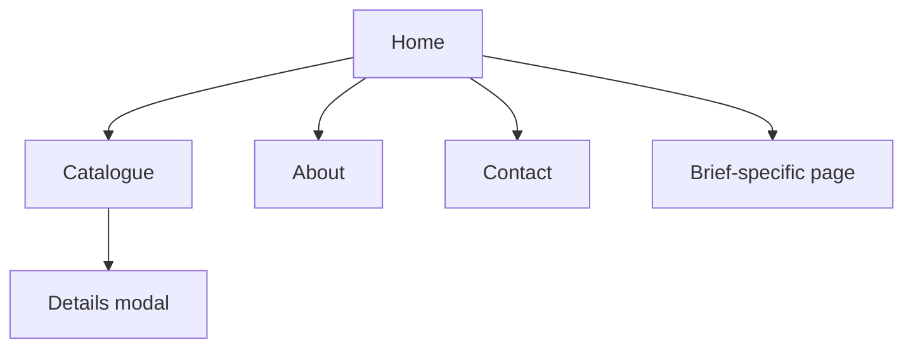

# Milestone 1 · Planning, Team and Repository Set-up

> [Capstone Project](../../README.md) › **Milestone 1** · Suggested timing: Week 1

**Goal:** a team, an approved idea, a plan everyone agrees on, and a shared GitHub repository containing the starter code.

## Tasks – step by step

1. **Form the team** (max. 4) and agree roles – for example *team lead / Git maintainer*, *UI designer*, *front-end
   developer (catalogue)*, *content & SEO*. Everyone still codes.
2. **Choose a brief** (A–E or your own) and write a one-paragraph **project vision**: who the site is for, what visitors
   must be able to do, and why.
3. **Write user stories** – at least 8, in the form *"As a ⟨visitor⟩, I want to ⟨action⟩ so that ⟨benefit⟩"*.
4. **Draw a sitemap** (the page hierarchy) and **wireframes** for every page at phone and desktop width (paper, Figma or
   draw.io).
5. **Plan the content**: list of catalogue items (≥ 12) with name, category, price, description and image source/licence.
6. **Create the repository**: one member creates it on GitHub, copies the contents of `starter-code/`, makes the first
   commit, adds teammates as collaborators, protects `main` (require a pull request) and enables GitHub Pages.
7. **Create issues** for every user story and a **GitHub Project** board (To do / In progress / Review / Done); assign
   owners.

```bash
git clone https://github.com/<team>/<repo>.git
cd <repo>
# copy the starter-code files into this folder, then:
git add .
git commit -m "chore: add capstone starter code"
git push origin main
```

## Deliverable
A short planning document in the repository (`docs/plan.md`) containing the vision, user stories, sitemap, wireframes
(images) and content list – plus the repository with issues and a project board.

## Acceptance checklist
- [ ] Team members and roles listed in the README
- [ ] ≥ 8 user stories as GitHub issues, each assigned
- [ ] Sitemap and phone + desktop wireframes for every page
- [ ] Repository with starter code, `main` protected, collaborators added, Pages enabled



<details><summary>💡 Hint – example user stories for Brief A (Karachi Eats)</summary>

- As a hungry visitor, I want to filter the menu by category so that I can find desserts quickly.
- As a visitor on my phone, I want a tap-to-call button so that I can order without typing a number.
- As a returning customer, I want to save favourite dishes so that I can reorder them next time.
- As a visitor, I want to see whether the restaurant is open now so that I don't call when it's closed.
</details>

---

[⬅ Capstone overview](../../README.md) · [Milestone 3 ➡](../02-html5-structure-and-content/README.md)

<sub>Prepared by **Hamna Zahid Khan**, Junior Lecturer</sub>
